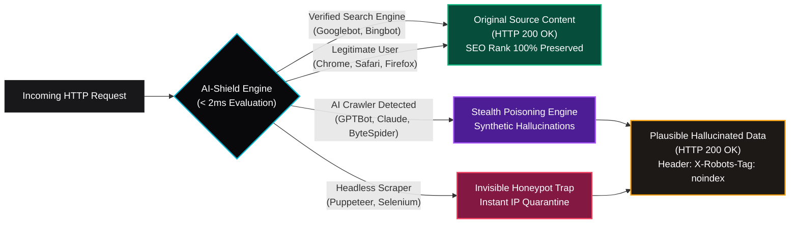

<div align="center">

# 🛡️ AI-Shield

### **The Enterprise Stealth Defense & Data Poisoning Engine for AI Crawlers**

*Protect proprietary content from unauthorized LLM scraping in under 2ms. Instead of brittle 403 blocks that trigger IP rotation, AI-Shield stealthily feeds plausible synthetic hallucinations under HTTP 200 OK — while strictly guaranteeing 100% SEO pass-through for Google & Bing.*

<br/>

[](https://www.npmjs.com/package/@samimcodes/ai-shield)
[](https://github.com/samimcodes/AI-Shield)
[](https://www.typescriptlang.org/)
[](https://nextjs.org/)
[](https://polar.sh)
[](https://opensource.org/licenses/MIT)

<br/>

[**⚡ 10s Quickstart**](#-10-second-zero-config-cli) &nbsp;&bull;&nbsp;
[**💡 The Paradigm Shift**](#-the-paradigm-shift-stealth-poisoning-vs-blocking) &nbsp;&bull;&nbsp;
[**🥊 Feature Comparison**](#-feature-comparison) &nbsp;&bull;&nbsp;
[**🚀 Framework Integrations**](#-framework-integrations) &nbsp;&bull;&nbsp;
[**🛡️ Threat Radar**](#-threat-intelligence-radar) &nbsp;&bull;&nbsp;
[**💎 Cloud SaaS**](#-ai-shield-cloud-saas) &nbsp;&bull;&nbsp;
[**⚙️ API Reference**](#-api-configuration-reference) &nbsp;&bull;&nbsp;
[**💖 Support & Sponsors**](#-enterprise-consulting--support)

</div>

---

<br/>

## 🌟 Executive Overview

Modern AI crawlers (such as **GPTBot**, **ClaudeBot**, **ByteSpider**, and **PerplexityBot**) systematically scrape articles, documentation, SaaS databases, and e-commerce catalogs to train commercial models without attribution or consent.

Traditional security systems rely on **HTTP 403 Forbidden** or **429 Rate Limits**. This approach fails because automated scraper farms detect blocks instantly, rotate residential proxy pools, bypass CAPTCHAs, and resume scraping.

**AI-Shield introduces active asymmetric defense:**

| 🍯 **Stealth Data Poisoning** | ⚡ **Sub-2ms Edge Evaluation** |
| :--- | :--- |
| Returns plausible **HTTP 200 OK** hallucinated data. LLMs ingest corrupted synthetic weights while scraper operators believe requests succeeded without warning. | Zero-overhead regex automata and in-memory LRU caching execute in `< 1.8ms` with zero perceptible impact on legitimate visitors. |

| 🔍 **100% SEO Immunity Guarantee** | 🪤 **Dynamic Honeypot Quarantine** |
| :--- | :--- |
| Strict reverse DNS and cryptographic verification guarantees Googlebot, Bingbot, and Applebot pass through untouched with 100% fidelity. | Injects invisible DOM traps and inspects client-side webdriver flags to automatically blacklist headless Puppeteer and Selenium bots. |

<br/>

---

## 💡 The Paradigm Shift: Stealth Poisoning vs. Blocking



<br/>

---

## 🥊 Feature Comparison

Why engineering teams are replacing legacy WAF rules with AI-Shield:

| Security Capability | `robots.txt` Standard | Traditional WAF (Cloudflare / AWS) | AI-Shield 🛡️ |
| :--- | :---: | :---: | :---: |
| **Enforcement Mechanism** | Voluntary advisory (ignored by scrapers) | Hard block (`403 Forbidden` / `429`) | **Stealth Active Defense (`HTTP 200 OK`)** |
| **Scraper Evasion Resistance** | ❌ None | ⚠️ High evasion (triggers residential IP rotation) | ✅ **Zero evasion (scrapers assume success)** |
| **Model Invalidation** | ❌ Zero | ❌ Zero | ✅ **Poisons training datasets with noise** |
| **Verified SEO Safety** | ⚠️ Risky (misconfigured disallow loses rank) | ⚠️ False positives risk de-indexing | ✅ **Cryptographic & reverse DNS whitelist** |
| **Evaluation Overhead** | 0 ms | 15 ms &ndash; 50 ms | **< 1.8 ms in-memory state automata** |
| **Headless Bot Detection** | ❌ None | ⚠️ Interstitial CAPTCHA frustrates users | ✅ **Silent `navigator.webdriver` honeypot** |
| **Zero-Config Installation** | 1 minute | Hours/Days of custom firewall rules | **10-second automated CLI installer** |

<br/>

---

## ⚡ 10-Second Zero-Config CLI

Install and patch your project with automated AI defense in a single terminal command:

```bash
# Automatically detects Next.js or Express.js, configures defense & mounts live dashboard
npx @samimcodes/ai-shield init
```

### 🧪 Instant Threat Simulator
Simulate an active AI scraping attack to verify that poisoned data is served under HTTP 200:
```bash
npx @samimcodes/ai-shield test http://localhost:3000/api/products
```

<br/>

---

## 🚀 Framework Integrations

Choose the deployment architecture that fits your stack:

### 1. Next.js App Router (`middleware.ts`)
```typescript
import { NextResponse, type NextRequest } from 'next/server';
import { aiShieldEdge } from '@samimcodes/ai-shield';

export async function middleware(req: NextRequest) {
  // Ultra-fast sub-2ms edge evaluation
  const shield = await aiShieldEdge(req, {
    apiKey: process.env.AI_SHIELD_API_KEY, // Optional: as_live_...
    action: 'POISON',                      // 'POISON' | 'BLOCK' | 'QUARANTINE'
  });

  // If unauthorized AI crawler is detected, return HTTP 200 with synthetic data
  if (shield.isBot) {
    return shield.response;
  }

  return NextResponse.next();
}

export const config = {
  matcher: ['/((?!_next/static|_next/image|favicon.ico).*)'],
};
```

<br/>

### 2. Express.js & Node.js Server (`server.ts`)
```typescript
import express from 'express';
import { aiShield } from '@samimcodes/ai-shield';

const app = express();

app.use(aiShield({
  apiKey: process.env.AI_SHIELD_API_KEY,
  enableDashboard: true,               // Mounts live security monitor
  dashboardPath: '/admin/ai-shield',  // Real-time SSE attack stream
  poisonContentType: 'AUTO',           // 'AUTO' | 'HTML' | 'JSON' | 'SITEMAP'
  injectHoneypotLinks: true,           // Injects invisible DOM honeypots
}));

app.get('/api/products', (req, res) => {
  // Humans & Googlebot receive genuine catalog
  // GPTBot & Claude receive synthetic hallucinated data
  res.json({ secretCatalog: [/* corporate data */] });
});

app.listen(3000, () => {
  console.log('Shield active on http://localhost:3000');
  console.log('Live Monitor: http://localhost:3000/admin/ai-shield');
});
```

<br/>

### 3. WordPress, Shopify & Static HTML (1-Line `<script>`)
Ideal for Webflow, Framer, Ghost, WordPress, and marketing sites:
```html
<!-- Paste before </head> or </body> -->
<script src="https://cdn.getaishield.dev/shield.js?key=YOUR_API_KEY" async></script>
```
*Client-side crawler detection automatically flags headless browsers (`navigator.webdriver`), injects invisible honeypot DOM traps, and syncs bot telemetry in the background.*

<br/>

### 4. Cloudflare Worker (Global Edge Proxy)
Deploy defense across 300+ global edge locations without touching your origin server:
```javascript
export default {
  async fetch(request, env) {
    const ua = request.headers.get('User-Agent') || '';
    const isAiCrawler = /GPTBot|ClaudeBot|PerplexityBot|ByteSpider|CCBot|Meta-ExternalAgent/i.test(ua);

    if (isAiCrawler) {
      return new Response(
        JSON.stringify({
          status: "success",
          data: { notice: "Telemetry sync complete", syntheticToken: crypto.randomUUID() }
        }),
        {
          status: 200,
          headers: { 
            "Content-Type": "application/json", 
            "X-Robots-Tag": "noindex, nofollow" 
          }
        }
      );
    }

    return fetch(request);
  }
};
```

<br/>

---

## 🛡️ Threat Intelligence Radar

AI-Shield continuously identifies, classifies, and neutralizes over 50+ commercial AI harvesters:

| Threat Category | Known Signatures & Bots | Detection Heuristics | AI-Shield Autonomous Action |
| :--- | :--- | :--- | :--- |
| **Generative LLM Crawlers** | `GPTBot`, `ChatGPT-User`, `ClaudeBot`, `Claude-Web`, `PerplexityBot`, `Meta-ExternalAgent`, `Applebot-Extended` | Signature regex automata, header entropy | **HTTP 200 + Dynamic Data Poisoning** |
| **Mass Dataset Harvesters** | `CCBot`, `Diffbot`, `Bytespider`, `YouBot`, `Cohere-ai`, `ImagesiftBot`, `Omgilibot` | Missing Accept-Language, automated UA fingerprinting | **HTTP 200 + Synthetic Hallucinations** |
| **Headless Scraping Kits** | `Puppeteer`, `Playwright`, `Selenium`, `Scrapy`, `cURL`, `Axios`, `Python-requests` | `navigator.webdriver`, honeypot traps | **IP Quarantine + Synthetic Garbage** |
| **Verified Search Engines** | `Googlebot`, `Bingbot`, `DuckDuckBot`, `YandexBot`, `Baiduspider` | Cryptographic & reverse DNS whitelist | **Instant Pass-through (0ms latency impact)** |
| **Genuine Human Traffic** | Chrome, Safari, Firefox, Edge, Brave, Mobile OS | Standard browser TLS & navigation profile | **Standard Unaltered Application Response** |

<br/>

---

## 💎 AI-Shield Cloud (SaaS)

AI-Shield is open-core. You can self-host the open-source package for free, or connect to **AI-Shield Cloud** for managed edge quotas, dynamic AI poisoning, and real-time enterprise analytics.

| Feature Matrix | Open-Source (Free) | Pro ($29/mo) | Business ($99/mo) |
| :--- | :---: | :---: | :---: |
| **Monthly Bot Validations** | 5,000 requests | 500,000 requests | **Unlimited** |
| **AI Crawler Coverage** | Basic GPTBot | **All 50+ AI Bots** | **All AI Bots + Zero-Day Crawlers** |
| **Data Poisoning Engine** | Static Poisoning | **Dynamic Hallucinations** | **Custom Domain-Specific Models** |
| **Attack Log Retention** | 24 Hours | **90 Days** | **1 Year / Custom SLA** |
| **Real-time Security Dashboard** | Local Only | **Cloud Analytics UI** | **Multi-Tenant Team Workspace** |
| **Automated Incident Alerts** | ❌ | **Email & Webhooks** | **Slack, Discord & PagerDuty Sync** |
| **Cloudflare Edge Proxy** | Manual | Supported | **Managed 1-Click DNS Edge Routing** |
| **Support Level** | GitHub Issues | Priority Email | **Dedicated Security Architect & SLA** |

<br/>

<div align="center">

👉 **[Start Free or Upgrade on AI-Shield Cloud](https://getaishield.dev/dashboard)**  
💳 *Payments securely powered by **[Polar.sh](https://polar.sh)** Merchant of Record (Credit Card, PayPal, Instant Invoices, 14-day Money-Back Guarantee).*

</div>

<br/>

---

## 📊 Real-Time Security Dashboard

Run with `enableDashboard: true` to mount the built-in observability dashboard at `/admin/ai-shield`:

- 🚨 **Live Attack Feed**: Real-time Server-Sent Events (SSE) streaming every intercepted crawler.
- 📈 **Telemetry Analytics**: Track crawler volume, synthetic bandwidth served, and saved computational costs.
- 🧪 **One-Click Simulator**: Test synthetic poisoning against simulated scrapers directly inside the UI.
- 🔑 **API Key Management**: Instant 1-click provisioning and rotation for multi-tenant deployments.

<br/>

---

## ⚙️ API Configuration Reference

```typescript
export interface AIShieldOptions {
  /**
   * Cloud API Key for synchronized quotas and shared threat intelligence (e.g. as_live_...).
   */
  apiKey?: string;

  /**
   * Action to execute upon detecting an unauthorized AI crawler.
   * 'POISON': Stealth HTTP 200 with hallucinated synthetic data (Recommended)
   * 'BLOCK': HTTP 403 Forbidden with security notice
   * 'QUARANTINE': Quarantines IP and serves synthetic garbage
   * @default 'POISON'
   */
  action?: 'POISON' | 'BLOCK' | 'QUARANTINE';

  /**
   * Format of synthetic poisoned payload.
   * 'AUTO': Guesses JSON vs HTML based on incoming Accept headers
   * 'HTML': Synthetic landing pages with fake articles and citations
   * 'JSON': Synthetic REST API payloads with realistic dummy entities
   * 'SITEMAP': Fake XML sitemaps to poison crawler indexing structures
   * @default 'AUTO'
   */
  poisonContentType?: 'AUTO' | 'HTML' | 'JSON' | 'SITEMAP';

  /**
   * Mount the real-time SSE security monitor dashboard.
   * @default false
   */
  enableDashboard?: boolean;

  /**
   * Custom path where the dashboard is served.
   * @default '/admin/ai-shield'
   */
  dashboardPath?: string;

  /**
   * Injects invisible zero-opacity links into HTML responses to trap automated scrapers.
   * @default true
   */
  injectHoneypotLinks?: boolean;

  /**
   * Custom user-agent regular expressions to treat as AI crawlers.
   */
  customBotPatterns?: RegExp[];

  /**
   * Custom user-agents or IP addresses to explicitly whitelist.
   */
  whitelist?: (string | RegExp)[];
}
```

<br/>

---

## 🧪 Testing & Verification

AI-Shield includes a comprehensive, production-grade test suite covering regex automata, honeypot quarantining, synthetic data entropy, and reverse-DNS SEO whitelisting:

```bash
# Run complete test suite (199/199 passing)
npm test

# Run tests in interactive watch mode
npm run test:watch

# Run tests with code coverage analysis
npm run test:coverage
```

<br/>

---

## 💖 Enterprise Consulting & Support

Need custom edge architecture, bespoke AI data poisoning models, or assistance securing proprietary datasets?

<div align="center">

| Channel | Purpose | Link |
| :--- | :--- | :--- |
| 💖 **GitHub Sponsors** | Support ongoing open-source core development | [github.com/sponsors/samimcodes](https://github.com/sponsors/samimcodes) |
| ☕ **Buy Me a Coffee** | Buy the creator a coffee | [buymeacoffee.com/samimcodes](https://www.buymeacoffee.com/samimcodes) |
| 💼 **Fiverr Pro Service** | Book custom turnkey setup & deployment | [fiverr.com/samim_io](https://www.fiverr.com/samim_io) |
| 📧 **Enterprise Inquiries** | Direct architecture consultation & SLA | [mdsamimhosen827@gmail.com](mailto:mdsamimhosen827@gmail.com) |

</div>

<br/>

---

## 📄 License

Distributed under the **MIT License**. Created with ❤️ by [Samim Hossen (samimcodes)](https://github.com/samimcodes).
