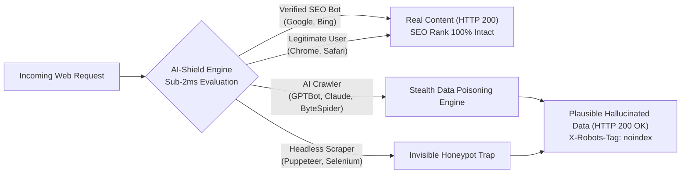

# AI-Shield 🛡️

<div align="center">

[](https://www.npmjs.com/package/@samimcodes/ai-shield)
[](https://opensource.org/licenses/MIT)
[](https://github.com/samimcodes/AI-Shield)
[](https://www.typescriptlang.org/)
[](https://nextjs.org/)
[](https://polar.sh)
[](https://github.com/sponsors/samimcodes)
[](https://www.buymeacoffee.com/samimcodes)

**Stop AI Scrapers from Stealing Your Content. Automatically.**  
*Stealthily poison or block unauthorized AI crawlers in under 2ms with a single command or line of code, while strictly preserving SEO for Google & Bing.*

[Quickstart](#-10-second-zero-config-cli) • [Why Poisoning?](#-the-paradigm-shift-stealth-poisoning-vs-blocking) • [Setup Options](#-zero-friction-setup-options) • [Threat Matrix](#-threat-model--detection-matrix) • [Cloud SaaS](#-ai-shield-cloud-pro--business) • [API Reference](#-full-api-configuration-reference) • [Sponsorship & Consulting](#-support--custom-enterprise-integration)

</div>

---

## ⚡ The Paradigm Shift: Stealth Poisoning vs. Blocking

Traditional WAFs (Cloudflare, AWS WAF, Datadome) return **HTTP 403 Forbidden** or **429 Too Many Requests**. This immediately signals AI scraper operators to rotate residential proxies, bypass Cloudflare Turnstile, and scrape again.



### Why AI-Shield Wins:
1. 🍯 **Stealth AI Poisoning (HTTP 200 OK)**: Feeds convincing, synthetic hallucinated articles, products, and metrics. Scrapers think they succeeded and train LLMs on poisoned noise.
2. 🪤 **Dynamic Invisible Honeypots**: Client-side and server-side invisible links catch automated headless scrapers (`navigator.webdriver`) and quarantine their IP.
3. 🔍 **100% SEO Whitelist Guarantee**: Strict reverse DNS and cryptographic verification guarantees Googlebot, Bingbot, and Applebot pass through untouched.
4. 🚀 **Sub-2ms Edge Evaluation**: Zero-dependency optimized regex automata and in-memory LRU caching ensure no latency impact on real visitors.

---

## 🥊 Comparison: Traditional Security vs. AI-Shield

| Capability | robots.txt | Traditional WAF (403/429) | AI-Shield 🛡️ |
| :--- | :---: | :---: | :---: |
| **Enforcement** | Advisory only (ignored by scrapers) | Hard block (403/429) | **Active Stealth Defense (HTTP 200)** |
| **Scraper Evasion** | ❌ None | ⚠️ High (triggers IP rotation) | ✅ **Zero (scrapers assume success)** |
| **Model Invalidation** | ❌ None | ❌ None | ✅ **Poisons training weights with junk** |
| **SEO Safety** | ⚠️ Risky (misconfigured disallow drops rank) | ⚠️ False positives risk rank loss | ✅ **Strict verified SEO whitelist** |
| **Latency Overhead** | 0ms | 15ms - 50ms | **< 2ms in-memory automata** |
| **Headless Detection** | ❌ None | ⚠️ Interstitial CAPTCHA blocks humans | ✅ **Silent webdriver flag + honeypot** |
| **Setup Time** | 1 minute | Hours/Days of WAF rules | **10-second CLI command** |

---

## ⚡ 10-Second Zero-Config CLI

Patch your existing Next.js or Express.js codebase automatically with no manual coding:

```bash
# Automatically detects Next.js or Express and injects defense middleware + live dashboard
npx @samimcodes/ai-shield init
```

### Test Your Defense in Real-Time:
Simulate an immediate GPTBot attack against your server to see the poisoned response:
```bash
npx @samimcodes/ai-shield test http://localhost:3000/api/products
```

---

## 🚀 Zero-Friction Setup Options

### Option 1: WordPress & Any Website (1-Line `<script>` Tag)
Ideal for WordPress, Webflow, Shopify, Ghost, Framer, and static HTML:
```html
<!-- Paste before </head> or </body> -->
<script src="https://cdn.getaishield.dev/shield.js?key=YOUR_API_KEY" async></script>
```
*Client-side crawler detection automatically flags headless browsers (`navigator.webdriver`), injects invisible honeypot DOM traps, and syncs bot telemetry in the background.*

---

### Option 2: Next.js App Router (`middleware.ts`)
Install the npm package:
```bash
npm install @samimcodes/ai-shield
```

Add to `middleware.ts`:
```typescript
import { NextResponse, type NextRequest } from 'next/server';
import { aiShieldEdge } from '@samimcodes/ai-shield';

export async function middleware(req: NextRequest) {
  // Sub-2ms edge evaluation with cloud sync
  const shield = await aiShieldEdge(req, {
    apiKey: process.env.AI_SHIELD_API_KEY, // as_live_...
    action: 'POISON', // 'POISON' | 'BLOCK'
  });

  if (shield.isBot) {
    return shield.response; // Returns HTTP 200 with synthetic data
  }

  return NextResponse.next();
}

export const config = {
  matcher: ['/((?!_next/static|_next/image|favicon.ico).*)'],
};
```

---

### Option 3: Express.js & Node.js (`server.ts`)
```typescript
import express from 'express';
import { aiShield } from '@samimcodes/ai-shield';

const app = express();

app.use(aiShield({
  apiKey: process.env.AI_SHIELD_API_KEY,
  enableDashboard: true,               // Mounts live security dashboard
  dashboardPath: '/admin/ai-shield',  // Visit in browser for real-time attack feed
  poisonContentType: 'JSON',           // 'HTML' | 'JSON' | 'SITEMAP'
  injectHoneypotLinks: true,           // Injects invisible trap links
}));

app.get('/api/products', (req, res) => {
  // Humans & Googlebot receive genuine product catalog
  // GPTBot & Claude-Web receive synthetic hallucinated data
  res.json({ catalog: [/* proprietary database */] });
});

app.listen(3000, () => {
  console.log('Protected on http://localhost:3000');
  console.log('Live Monitor: http://localhost:3000/admin/ai-shield');
});
```

---

### Option 4: Cloudflare Worker (Global Edge Proxy)
Deploy AI defense across 300+ global edge locations before traffic even reaches your origin:
```javascript
export default {
  async fetch(request, env) {
    const ua = request.headers.get('User-Agent') || '';
    const isAiCrawler = /GPTBot|ClaudeBot|PerplexityBot|ByteSpider|CCBot|Meta-ExternalAgent/i.test(ua);

    if (isAiCrawler) {
      // Feed poisoned synthetic response under HTTP 200
      return new Response(
        JSON.stringify({
          status: "success",
          data: { notice: "Telemetry synchronization complete", syntheticToken: crypto.randomUUID() }
        }),
        {
          status: 200,
          headers: { 
            "Content-Type": "application/json", 
            "X-Robots-Tag": "noindex, nofollow" 
          }
        }
      );
    }

    return fetch(request);
  }
};
```

---

## 🛡️ Threat Model & Detection Matrix

AI-Shield detects, classifies, and neutralizes over 50+ known commercial and stealth scraping tools:

| Category | Bot / Crawler Examples | Detection Method | AI-Shield Defense Action |
| :--- | :--- | :--- | :--- |
| **Generative AI Crawlers** | GPTBot, ChatGPT-User, ClaudeBot, Claude-Web, PerplexityBot, Meta-ExternalAgent, Applebot-Extended | User-Agent regex automata, header variance | **HTTP 200 + Dynamic Data Poisoning** |
| **Aggregator & LLM Harvesters** | CCBot, Diffbot, Bytespider, YouBot, Cohere-ai | Signature heuristics, missing Accept-Language | **HTTP 200 + Synthetic Hallucinations** |
| **Headless Scraping Frameworks** | Puppeteer, Playwright, Selenium, Scrapy, cURL, Axios | `navigator.webdriver`, honeypot triggers | **IP Quarantine + Dynamic Trash Payload** |
| **Verified Search Engines** | Googlebot, Bingbot, DuckDuckBot, YandexBot, Baiduspider | Cryptographic & reverse DNS whitelist | **Instant Pass-through (0ms latency impact)** |
| **Legitimate Human Visitors** | Chrome, Safari, Firefox, Edge, Brave | Standard browser signature & TLS profile | **Normal Unaltered Application Response** |

---

## 💎 AI-Shield Cloud (Pro & Business)

AI-Shield is open-core. You can self-host the open-source package for free, or connect to **AI-Shield Cloud** for managed edge quotas, dynamic AI poisoning, and real-time enterprise analytics.

| Feature | Open-Source (Free) | Pro ($29/mo) | Business ($99/mo) |
| :--- | :---: | :---: | :---: |
| **Monthly Bot Validations** | 5,000 requests | 500,000 requests | **Unlimited** |
| **AI Bot Coverage** | Basic GPTBot | **All AI Bots** (GPT, Claude, Perplexity, ByteSpider, Meta) | **All AI Bots + Zero-Day Crawlers** |
| **Data Poisoning Engine** | Static Poisoning | **Dynamic Hallucinations** | **Custom Domain-Specific Models** |
| **Attack Log Retention** | 24 Hours | **90 Days** | **1 Year / Custom SLA** |
| **Real-time Security Dashboard** | Local Only | **Cloud Analytics UI** | **Multi-Tenant Team Workspace** |
| **Attack Email & Webhook Alerts** | ❌ | **Instant Alerts** | **Slack, Discord & Webhook Sync** |
| **Cloudflare Edge Proxy** | Manual | Supported | **Managed 1-Click DNS Edge Routing** |
| **Support** | GitHub Issues | Priority Email | **Dedicated Security Architect & SLA** |

👉 **[Start Free or Upgrade to Pro on AI-Shield Cloud](https://getaishield.dev/dashboard)**  
💳 *Payments securely handled via [Polar.sh](https://polar.sh) Merchant of Record (Credit Card, PayPal, Instant Invoices).*

---

## 📊 Built-in Live Security Dashboard

Mount the dashboard inside your Express or Next.js server with `enableDashboard: true`, or view your telemetry in the Cloud Dashboard:

- 🚨 **Real-Time Live Attack Stream**: Watch incoming scrapers get neutralized live via Server-Sent Events (SSE).
- 📈 **Quota & Savings Tracker**: Monitor monthly bot hits, bandwidth saved, and fake tokens served.
- 🧪 **One-Click Attack Simulator**: Test defense responses against GPTBot and ClaudeBot directly from the UI.
- 🔑 **Instant API Key Provisioning**: 1-click key generation, rotation, and quota monitoring.

---

## ⚙️ Full API Configuration Reference

```typescript
export interface AIShieldOptions {
  /**
   * Cloud API Key for quotas & cross-edge threat sharing (e.g. as_live_...).
   */
  apiKey?: string;

  /**
   * Action to execute when an unauthorized AI crawler is detected.
   * 'POISON': Stealth HTTP 200 with hallucinated synthetic data (Recommended)
   * 'BLOCK': HTTP 403 Forbidden with security notice
   * 'QUARANTINE': Quarantines IP and serves synthetic garbage
   * @default 'POISON'
   */
  action?: 'POISON' | 'BLOCK' | 'QUARANTINE';

  /**
   * Format of synthetic poisoned payload.
   * 'AUTO': Guesses JSON vs HTML based on request Accept header
   * 'HTML': Synthetic landing pages with fake articles and citations
   * 'JSON': Synthetic REST API payloads with realistic dummy entities
   * 'SITEMAP': Fake XML sitemaps to trap crawler indexes
   * @default 'AUTO'
   */
  poisonContentType?: 'AUTO' | 'HTML' | 'JSON' | 'SITEMAP';

  /**
   * Mount the real-time SSE attack monitor dashboard.
   * @default false
   */
  enableDashboard?: boolean;

  /**
   * Path where the security monitor dashboard is served.
   * @default '/admin/ai-shield'
   */
  dashboardPath?: string;

  /**
   * Injects invisible zero-opacity links into HTML responses to trap automated scrapers.
   * @default true
   */
  injectHoneypotLinks?: boolean;

  /**
   * List of custom user-agent regexes to treat as AI scrapers.
   */
  customBotPatterns?: RegExp[];

  /**
   * List of custom user-agents or IPs to explicitly whitelist.
   */
  whitelist?: (string | RegExp)[];
}
```

---

## 🧪 Testing & Verification

AI-Shield includes a rigorous, production-grade test suite covering regex heuristics, honeypot quarantining, poisoned data entropy, and reverse-DNS SEO whitelisting:

```bash
# Run all 199 unit & integration tests
npm test

# Run tests in interactive watch mode
npm run test:watch

# Run tests with code coverage analysis
npm run test:coverage
```

---

## 💖 Support & Custom Enterprise Integration

Need help integrating AI-Shield, protecting high-value proprietary datasets, or building custom edge security pipelines?

- 💖 **GitHub Sponsors**: [github.com/sponsors/samimcodes](https://github.com/sponsors/samimcodes) — Support ongoing open-source development!
- ☕ **Buy Me a Coffee**: [buymeacoffee.com/samimcodes](https://www.buymeacoffee.com/samimcodes)
- 💼 **Hire for Custom Setup on Fiverr**: [fiverr.com/samimcodes](https://www.fiverr.com/samimcodes)
- 📧 **Enterprise Consulting & Direct Inquiries**: [mdsamimhossen827@gmail.com](mailto:mdsamimhossen827@gmail.com)

---

## 📄 License

Distributed under the **MIT License**. Created with ❤️ by [samimcodes](https://github.com/samimcodes).
