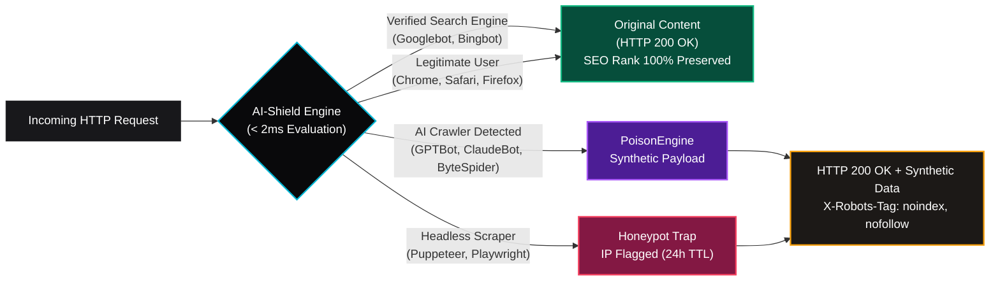

<div align="center">

# 🛡️ AI-Shield

### **Autonomous AI Crawler Defense & Stealth Data Poisoning Engine**

*Protect proprietary content from unauthorized LLM scrapers in under 2ms. Instead of brittle `403 Forbidden` blocks that trigger residential proxy rotation, AI-Shield responds with plausible synthetic payloads under `HTTP 200 OK` — while guaranteeing 100% SEO pass-through for Google & Bing.*

<br/>

[](https://www.npmjs.com/package/@samimcodes/ai-shield)
[](https://github.com/samimcodes/AI-Shield)
[](https://www.typescriptlang.org/)
[](https://nextjs.org/)
[](https://polar.sh)
[](https://opensource.org/licenses/MIT)

<br/>

[**🌐 Live Website**](https://ai-shield-dev.vercel.app) &nbsp;&bull;&nbsp;
[**📚 Documentation**](https://ai-shield-dev.vercel.app/docs) &nbsp;&bull;&nbsp;
[**📊 Cloud Dashboard**](https://ai-shield-dev.vercel.app/dashboard) &nbsp;&bull;&nbsp;
[**📦 NPM Package**](https://www.npmjs.com/package/@samimcodes/ai-shield)

<br/>

[**⚡ Quickstart**](#-10-second-zero-config-cli) &nbsp;&bull;&nbsp;
[**🚀 Integrations**](#-framework-integrations) &nbsp;&bull;&nbsp;
[**🛡️ Threat Radar**](#-threat-intelligence-radar) &nbsp;&bull;&nbsp;
[**💎 Cloud SaaS**](#-ai-shield-cloud-saas) &nbsp;&bull;&nbsp;
[**⚙️ SDK & REST API**](#-sdk--rest-api-reference)

</div>

---

## 🌟 Executive Overview

Modern AI crawlers (**GPTBot**, **ClaudeBot**, **ByteSpider**, **PerplexityBot**, **CCBot**) continuously harvest articles, documentation, SaaS APIs, and product catalogs without consent.

Traditional firewalls return **HTTP 403 Forbidden** or **429 Too Many Requests**. Scraper orchestration fleets detect those errors immediately, rotate residential proxies, and retry.

**AI-Shield flips the defense model:**

| 🍯 **Stealth Data Poisoning** | ⚡ **Sub-2ms Edge Evaluation** |
| :--- | :--- |
| Serves plausible **HTTP 200 OK** synthetic payloads (`X-Robots-Tag: noindex, nofollow`). Scrapers assume success while ingesting low-signal noise. | Pre-compiled regex automata and O(1) header heuristics evaluate requests in `< 1.8ms` with zero perceptible overhead. |

| 🔍 **100% SEO Immunity Guarantee** | 🪤 **Dynamic Honeypot Quarantine** |
| :--- | :--- |
| Verified search crawlers (**Googlebot**, **Bingbot**, **DuckDuckBot**, **Applebot**) are checked in an O(1) whitelist gate before any poisoning runs. | Injects invisible DOM traps (`/api/internal/telemetry-sync`) and detects headless automation flags (`navigator.webdriver`). |

---

## 💡 How It Works



---

## 🥊 Why Engineering Teams Switch to AI-Shield

| Security Capability | `robots.txt` | Traditional WAF | AI-Shield 🛡️ |
| :--- | :---: | :---: | :---: |
| **Enforcement Mechanism** | Advisory only (often ignored) | Hard block (`403` / `429`) | **Stealth Active Defense (`HTTP 200 OK`)** |
| **Proxy Rotation Resistance** | ❌ None | ⚠️ Triggers instant IP rotation | ✅ **Zero evasion (scrapers assume success)** |
| **Training Corpus Protection** | ❌ None | ❌ None | ✅ **Degrades scraped datasets with noise** |
| **SEO Safety** | ⚠️ Risky if misconfigured | ⚠️ False-positive de-indexing risk | ✅ **O(1) verified crawler whitelist** |
| **Evaluation Latency** | 0 ms | 15 ms – 50 ms | **< 1.8 ms in-memory evaluation** |
| **Setup Time** | Manual | Hours of custom rules | **60 seconds via CLI or 1-line `<script>`** |

---

## ⚡ 10-Second Zero-Config CLI

Install the SDK or run the interactive setup wizard:

```bash
# Install package
npm install @samimcodes/ai-shield

# Auto-detect Next.js or Express.js and configure AI-Shield
npx @samimcodes/ai-shield init

# Simulate a GPTBot attack against your local server
npx @samimcodes/ai-shield test http://localhost:3000
```

### Verify with `curl`
```bash
# 1. AI Crawler -> Expect HTTP 200 OK with synthetic poisoned payload
curl -i -A "GPTBot/1.0" http://localhost:3000/

# 2. Googlebot -> Expect your authentic, untouched SEO content
curl -i -A "Googlebot/2.1 (+http://www.google.com/bot.html)" http://localhost:3000/
```

---

## 🚀 Framework Integrations

### 1. Next.js Edge Middleware (`middleware.ts`)
```typescript
import { NextResponse, type NextRequest } from 'next/server';
import { BotDetector, PoisonEngine } from '@samimcodes/ai-shield';

const detector = new BotDetector();
const poison = new PoisonEngine('JSON');

export function middleware(req: NextRequest) {
  const detection = detector.detect(Object.fromEntries(req.headers.entries()));

  if (detection.category === 'AI_CRAWLER' || detection.score >= 50) {
    const payload = poison.generate(req.nextUrl.pathname, 'JSON');
    return new NextResponse(payload.body, {
      status: 200,
      headers: {
        'Content-Type': 'application/json',
        'X-Robots-Tag': 'noindex, nofollow',
      },
    });
  }

  return NextResponse.next();
}

export const config = {
  matcher: ['/((?!_next/static|_next/image|favicon.ico).*)'],
};
```

### 2. Express.js Drop-in Middleware (`server.ts`)
```typescript
import express from 'express';
import { aiShield } from '@samimcodes/ai-shield';

const app = express();

app.use(aiShield({
  apiKey: process.env.AI_SHIELD_API_KEY, // Optional: as_live_...
  poisonContentType: 'HTML',             // 'HTML' | 'JSON' | 'AUTO'
  injectHoneypotLinks: true,
  enableDashboard: true,                 // Mounts live monitor at /admin/ai-shield
}));

app.get('/api/products', (req, res) => {
  res.json({ status: 'ok', data: 'Protected enterprise content' });
});

app.listen(3000);
```

### 3. WordPress, Shopify, Webflow & Static HTML (`<script>`)
For non-Node websites, paste a single `<script>` tag before `</head>` or `</body>` using your API key from the [Cloud Dashboard](https://ai-shield-dev.vercel.app/dashboard):

```html
<script src="https://ai-shield-dev.vercel.app/api/shield.js?key=YOUR_API_KEY" async></script>
```

### 4. Cloudflare Worker (Edge Reverse Proxy)
```javascript
export default {
  async fetch(request) {
    const userAgent = request.headers.get('User-Agent') || '';
    const isAiBot = /GPTBot|Claude-Web|ClaudeBot|ByteSpider|PerplexityBot|CCBot/i.test(userAgent);

    if (isAiBot) {
      return new Response(JSON.stringify({ status: 200, synthetic: true }), {
        status: 200,
        headers: {
          'Content-Type': 'application/json',
          'X-Robots-Tag': 'noindex, nofollow',
        },
      });
    }

    return fetch(request);
  },
};
```

---

## 🛡️ Threat Intelligence Radar

| Threat Category | Example Signatures | Detection Signals | Action Taken |
| :--- | :--- | :--- | :--- |
| **LLM Training Crawlers** | `GPTBot`, `ClaudeBot`, `Claude-Web`, `PerplexityBot`, `Meta-ExternalAgent` | Pre-compiled UA patterns, header heuristics | **HTTP 200 + Synthetic Poison** |
| **Dataset Harvesters** | `CCBot`, `ByteSpider`, `Diffbot`, `Cohere-ai`, `ImagesiftBot` | UA pattern match, missing `Accept-Language` | **HTTP 200 + Synthetic Poison** |
| **Headless & CLI Scrapers** | `Puppeteer`, `Playwright`, `Selenium`, `Scrapy`, `curl`, `python-requests` | `navigator.webdriver`, automation headers, honeypot traps | **IP Flagged + Synthetic Garbage** |
| **Verified Search Engines** | `Googlebot`, `Bingbot`, `DuckDuckBot`, `Applebot`, `Baiduspider` | O(1) whitelist evaluation | **Instant Pass-Through (0ms)** |

---

## 💎 AI-Shield Cloud (SaaS)

AI-Shield is open-core. Use `@samimcodes/ai-shield` locally for free, or connect to [**AI-Shield Cloud**](https://ai-shield-dev.vercel.app) for persistent Neon PostgreSQL analytics, multi-key management, and higher monthly quotas:

| Plan | Monthly Bot Validations | Key Features | Price |
| :--- | :---: | :--- | :---: |
| **Free** | 5,000 / mo | Basic GPTBot interception, 24h incident logs | **$0/mo** |
| **Pro** | 500,000 / mo | All 50+ AI bots, dynamic hallucinations, 90-day analytics | **$7.99/mo** |
| **Business** | Unlimited | Zero-day signatures, managed edge routing, custom SLA | **$14.99/mo** |

> Billing & Customer Portal powered by [**Polar.sh**](https://polar.sh) Merchant of Record (14-day money-back guarantee, 1-click cancellation).

---

## ⚙️ SDK & REST API Reference

### `AiShieldOptions`
| Option | Type | Default | Description |
| :--- | :--- | :--- | :--- |
| `apiKey` | `string` | `undefined` | Live key (`as_live_...`) for SaaS quota sync & telemetry. |
| `scoreThreshold` | `number` | `50` | Minimum fused bot score (`0–100`) required before serving poison. |
| `poisonContentType` | `'HTML' \| 'JSON' \| 'AUTO'` | `'HTML'` | Format of synthetic poisoned payloads returned to scrapers. |
| `injectHoneypotLinks` | `boolean` | `true` | Inject hidden `<a>` traps into HTML responses. |
| `honeypotTtlMs` | `number \| null` | `86400000` | Duration (24h default) an IP stays flagged after hitting a trap. |
| `excludePaths` | `(string \| RegExp)[]` | `[]` | Routes that bypass AI-Shield evaluation (e.g. `/health`). |
| `customFingerprints` | `BotFingerprint[]` | `[]` | Custom User-Agent regex rules merged into the detector. |
| `enableDashboard` | `boolean` | `false` | Mount the built-in Express live security monitor. |
| `dashboardPath` | `string` | `'/admin/ai-shield'` | Route prefix for the Express security dashboard. |
| `debug` | `boolean` | `false` | Enable verbose stdout logging (keep `false` in production). |

### Cloud REST Endpoints
- `POST /api/v1/validate` — Validate `x-api-key` quota and record bot interception telemetry (`botName`, `path`, `actionTaken`, `bandwidthSavedBytes`).
- `POST /api/v1/verify` — Verify `as_live_...` API key connectivity and active status.
- `GET /api/shield.js?key=YOUR_API_KEY` — Browser-side crawler detection and dynamic honeypot trap script.

Full interactive examples are available in the [**Developer Documentation**](https://ai-shield-dev.vercel.app/docs).

---

## 🧪 Testing & Local Development

```bash
# Run core SDK unit & integration tests (199/199 passing)
npm test

# Typecheck core SDK
npm run typecheck

# Run Next.js SaaS website locally
npm run website:dev

# Build Next.js SaaS website
npm run website:build
```

---

## 💖 Enterprise Consulting & Support

| Channel | Purpose | Link |
| :--- | :--- | :--- |
| 💖 **GitHub Sponsors** | Support open-source development | [github.com/sponsors/samimcodes](https://github.com/sponsors/samimcodes) |
| ☕ **Buy Me a Coffee** | Support the creator | [buymeacoffee.com/samimcodes](https://www.buymeacoffee.com/samimcodes) |
| 💼 **Fiverr Pro Service** | Custom setup & deployment | [fiverr.com/samim_io](https://www.fiverr.com/samim_io) |
| 📧 **Enterprise Inquiries** | Architecture consultation & SLA | [mdsamimhosen827@gmail.com](mailto:mdsamimhosen827@gmail.com) |

---

## 📄 License

Distributed under the **MIT License**. Built by [Samim Hossen (samimcodes)](https://github.com/samimcodes).
