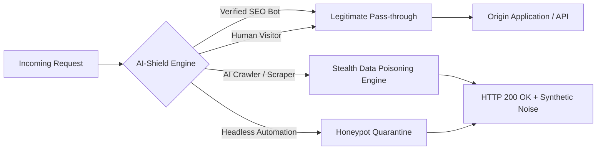

<div align="center">

# AI-Shield 🛡️

**Next-generation stealth defense against unauthorized AI crawlers.**  
*Neutralize AI scrapers with dynamic data poisoning in under 2ms — without affecting SEO.*

[](https://www.npmjs.com/package/@samimcodes/ai-shield)
[](https://github.com/samimcodes/AI-Shield)
[](https://opensource.org/licenses/MIT)
[](https://www.typescriptlang.org/)
[](https://github.com/sponsors/samimcodes)

[Quickstart](#-quickstart) • [How It Works](#-how-it-works) • [Integrations](#-integrations) • [Threat Matrix](#-threat-matrix) • [Cloud](#-ai-shield-cloud) • [Documentation](https://getaishield.dev/docs)

</div>

---

## ⚡ Highlights

Traditional firewalls return **HTTP 403 Forbidden**, which immediately instructs scrapers to rotate residential IPs and bypass defenses. **AI-Shield** alters the equation with active counter-measures:

* **Stealth Data Poisoning (HTTP 200 OK)** — Feeds synthetic, hallucinated datasets to crawlers. AI scrapers ingest junk data without knowing they were flagged.
* **Guaranteed SEO Safety** — Verified search engines (Googlebot, Bingbot, Applebot) pass through via cryptographic and reverse DNS verification with zero latency impact.
* **Invisible Honeypots** — Silently flags headless browsers (`navigator.webdriver`, Puppeteer, Playwright) and quarantines scraper IP subnets.
* **Sub-2ms Edge Evaluation** — Lightweight regex automata with in-memory caching designed for high-throughput edge runtimes.

---

## 🚀 Quickstart

### Automated Setup (Recommended)

Run the zero-configuration setup wizard in your existing Next.js or Express.js project:

```bash
npx @samimcodes/ai-shield init
```

To test that your endpoint intercepts AI scrapers:

```bash
npx @samimcodes/ai-shield test http://localhost:3000/api/products
```

---

### Manual Installation

```bash
npm install @samimcodes/ai-shield
```

#### Next.js (App Router)

Create or update `middleware.ts`:

```typescript
import { NextResponse, type NextRequest } from 'next/server';
import { aiShieldEdge } from '@samimcodes/ai-shield';

export async function middleware(req: NextRequest) {
  const shield = await aiShieldEdge(req, {
    action: 'POISON', // 'POISON' | 'BLOCK'
  });

  if (shield.isBot) {
    return shield.response; // Returns HTTP 200 with synthetic payload
  }

  return NextResponse.next();
}

export const config = {
  matcher: ['/((?!_next/static|_next/image|favicon.ico).*)'],
};
```

---

## 🧠 How It Works



### Threat Matrix & Coverage

| Category | Target Crawlers | Detection Method | Defense Action |
| :--- | :--- | :--- | :--- |
| **Generative AI Crawlers** | GPTBot, ClaudeBot, PerplexityBot, Meta-ExternalAgent | Signature regex, header heuristics | **HTTP 200 + Synthetic Poisoning** |
| **Scraper Frameworks** | Puppeteer, Playwright, Selenium, Scrapy, Axios | `navigator.webdriver`, DOM honeypots | **IP Quarantine + Dynamic Trash** |
| **Verified Search Engines** | Googlebot, Bingbot, DuckDuckBot | Strict reverse-DNS & ASN whitelist | **Instant Pass-through (0ms overhead)** |
| **Legitimate Users** | Chrome, Safari, Firefox, Edge | Standard TLS & browser profile | **Normal Application Response** |

---

## 🔌 Integrations

<details>
<summary><b>Express.js / Node.js Server</b></summary>

```typescript
import express from 'express';
import { aiShield } from '@samimcodes/ai-shield';

const app = express();

app.use(aiShield({
  enableDashboard: true,              // Real-time security feed at /admin/ai-shield
  poisonContentType: 'AUTO',          // 'AUTO' | 'HTML' | 'JSON' | 'SITEMAP'
  injectHoneypotLinks: true,          // Silently traps automated scrapers
}));

app.get('/api/products', (req, res) => {
  res.json({ products: [{ id: 1, name: 'Original Asset' }] });
});

app.listen(3000);
```
</details>

<details>
<summary><b>WordPress & Static Sites (1-Line Script Tag)</b></summary>

Paste directly before `</head>` or `</body>`:

```html
<script src="https://cdn.getaishield.dev/shield.js?key=YOUR_API_KEY" async></script>
```
</details>

<details>
<summary><b>Cloudflare Workers (Edge Gateway)</b></summary>

```javascript
export default {
  async fetch(request) {
    const ua = request.headers.get('User-Agent') || '';
    const isBot = /GPTBot|ClaudeBot|PerplexityBot|ByteSpider|CCBot/i.test(ua);

    if (isBot) {
      return new Response(
        JSON.stringify({ status: "ok", data: { syntheticToken: crypto.randomUUID() } }),
        { status: 200, headers: { "Content-Type": "application/json", "X-Robots-Tag": "noindex" } }
      );
    }

    return fetch(request);
  }
};
```
</details>

<details>
<summary><b>Configuration Reference (TypeScript)</b></summary>

```typescript
interface AIShieldOptions {
  apiKey?: string;                                    // Cloud API Key (as_live_...)
  action?: 'POISON' | 'BLOCK' | 'QUARANTINE';         // Default: 'POISON'
  poisonContentType?: 'AUTO' | 'HTML' | 'JSON';       // Default: 'AUTO'
  enableDashboard?: boolean;                          // Default: false
  dashboardPath?: string;                             // Default: '/admin/ai-shield'
  injectHoneypotLinks?: boolean;                      // Default: true
  customBotPatterns?: RegExp[];                       // Custom crawler signatures
  whitelist?: (string | RegExp)[];                    // Whitelisted paths or IPs
}
```
</details>

---

## 💎 AI-Shield Cloud

AI-Shield is open-core. Self-host the core engine for free, or connect to **AI-Shield Cloud** for managed edge quotas, dynamic AI poisoning, and real-time observability.

| Tier | Monthly Validations | AI Crawler Coverage | Data Poisoning Engine | Log Retention | Dashboard |
| :--- | :---: | :---: | :---: | :---: | :---: |
| **Community** | 5,000 requests | Core LLM Crawlers | Static Poisoning | 24 Hours | Local SSE |
| **Pro** ($29/mo) | 500,000 requests | Full AI & Scraper Suite | Dynamic Hallucinations | 90 Days | Cloud Analytics UI |
| **Business** ($99/mo) | Unlimited | Zero-Day Crawlers | Custom Domain Models | 1 Year / Custom | Multi-Tenant Workspace |

👉 **[Get Started on AI-Shield Cloud](https://getaishield.dev/dashboard)** • Secure billing powered by [Polar.sh](https://polar.sh)

---

## 🧪 Testing

```bash
# Run all 199 unit & integration tests
npm test

# Run tests in watch mode
npm run test:watch
```

---

## 🤝 Community & Support

* **Documentation**: [getaishield.dev/docs](https://getaishield.dev/docs)
* **GitHub Sponsors**: [github.com/sponsors/samimcodes](https://github.com/sponsors/samimcodes)
* **Issues & Discussions**: [GitHub Issues](https://github.com/samimcodes/AI-Shield/issues)
* **Enterprise Consulting**: [mdsamimhossen827@gmail.com](mailto:mdsamimhossen827@gmail.com)

---

## 📄 License

Distributed under the **MIT License**. Created with ❤️ by [samimcodes](https://github.com/samimcodes).
